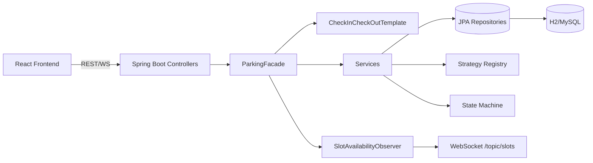
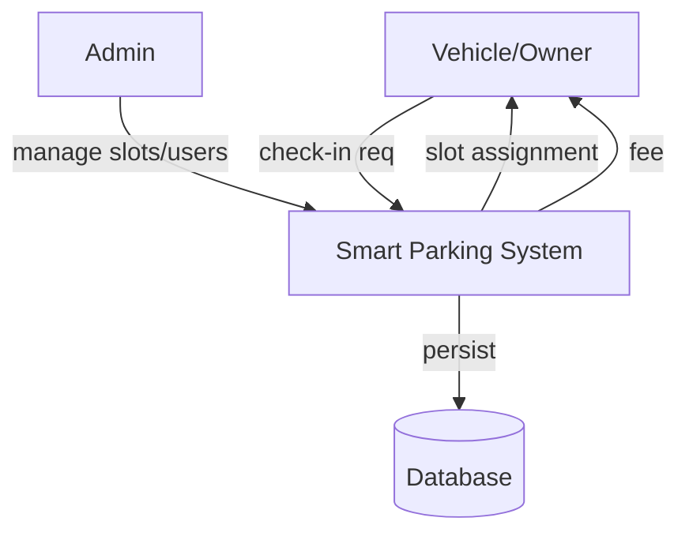
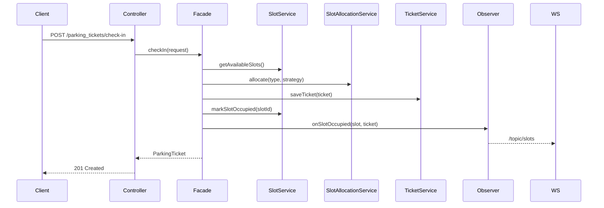
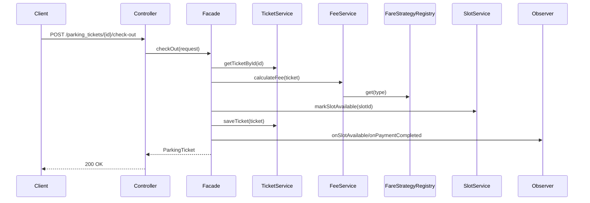
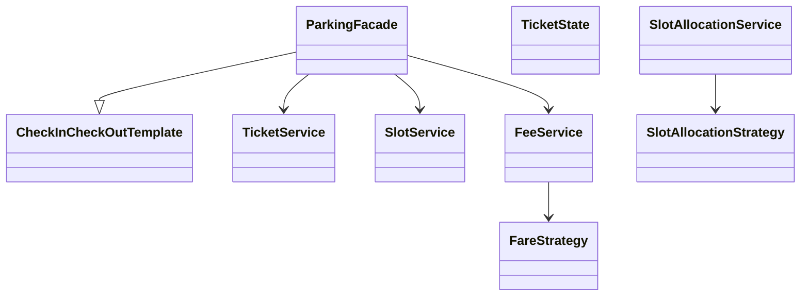

# Smart Parking Lot

Backend + frontend system for managing a multi-floor smart parking lot: spot allocation, check-in/check-out, fee calculation, real-time availability, RBAC auth, and owner self-service.

## Description
A Spring Boot (Java 25) REST API with an H2 (dev) / MySQL (prod) database, secured with JWT + role/privilege RBAC, plus a React + Vite + TypeScript frontend. Implements multiple design patterns (Strategy, State, Template Method, Observer, Facade, Memento, Visitor, Factory) for parking workflows.

## Setup

### Prerequisites
- Java 25 (JDK)
- Gradle (wrapper provided)
- Node.js 20+ and npm (frontend)

### Backend
```bash
./gradlew bootRun
```
Default profile runs on `http://localhost:8080` with in-memory H2 (`spring.datasource.url=jdbc:h2:mem:testdb`).

### Profiles
```bash
./gradlew bootRun --args='--spring.profiles.active=dev'
./gradlew bootRun --args='--spring.profiles.active=prod'
```
- `dev`: H2 file DB at `./data/parkinglotdb-dev`, ddl-auto=update, DEBUG logging
- `prod`: MySQL (uncomment JDBC props in `application-prod.properties`), ddl-auto=validate

### Frontend
```bash
cd front-end/smart-parking-lot
npm install
npm run dev
```
Dev server: `http://localhost:5173` (CORS origin configured for backend).

## Initial Setup (curl script)
Run the provided RBAC bootstrap script against a running backend:
```bash
bash first_initial_setup.sh
```
It logs in as `admin/admin123`, creates roles, privileges, assigns them, and seeds the admin user. See `docs/RBACCurlSetup.md` for manual steps.

## Core Features (per problem statement)
- Parking spot allocation by vehicle size/type (motorcycle, car, bus) via Strategy pattern (`NearestSlotStrategy`, `BestFitByTypeStrategy`).
- Check-in and check-out with entry/exit time tracking.
- Fee calculation based on duration and vehicle type (hourly/daily rates, multipliers).
- Real-time availability updates via Observer + WebSocket (`/topic/slots`).
- Concurrency handling via pessimistic locking (`findByIdWithLock`, `findAvailableSlotsWithLock`).
- RBAC auth (roles/privileges), owner registration, owner-scoped data access.
- Batch check-in, undo last check-in (Memento), overstay scanning (Visitor).
- Pagination/sorting on list endpoints.

## Architecture & Design Patterns



Patterns: Strategy (fare/slot allocation), State (ticket lifecycle), Template Method (check-in/out flow), Facade (ParkingFacade), Observer (slot events), Memento (undo check-in), Visitor (overstay scan), Factory (vehicle type/slot allocation).

## Diagrams

### DFD (Level 0)


### Sequence (Check-in)


### Sequence (Check-out)


### Class Diagram (core)


## Fee Calculation Engine
- Entry: `FeeService.calculateFee(ParkingTicket)` validates both times, computes `Duration.between(checkIn, checkOut)`.
- Strategy lookup via `FareStrategyRegistry.get(typeName)` (case-insensitive map).
- Strategies:
  - `TwoWheelerFareStrategy`: `hours * hourlyRate` (min 1 hour).
  - `CarFareStrategy`: `max(hours*hourlyRate, (hours/24)*dailyRate)`.
  - `BusFareStrategy`: same as car then `* 1.5`.
- Results stored on ticket: `hourlyRate`, `baseFee`, `totalFee`.
- Ticket state machine guards re-checkout/cancellation.

## Test Suite Setup
Backend tests use JUnit 5 + Mockito + Spring Boot test starters.
```bash
./gradlew test
```
Test classes: `FeeServiceTest`, `SlotAllocationServiceTest`, `SlotServiceTest`, `ParkingSlotServiceTest`, `TicketServiceTest`, `VehicleDetailsServiceTest`, `VehicleOwnerServiceTest`, `ApplicationTests`.

Frontend lint:
```bash
cd front-end/smart-parking-lot
npm run lint
npm run build
```

## Code Coverage
Backend: add JaCoCo plugin to `build.gradle`:
```groovy
plugins { id 'jacoco' }
test { finalizedBy jacocoTestReport }
jacocoTestReport { reports { xml.required = true; html.required = true } }
```
Then:
```bash
./gradlew test jacocoTestReport
# report: build/reports/jacoco/test/html/index.html
```
Frontend: use `@vitest/coverage-v8` with `npm run test -- --coverage`.

### Package-Level Coverage Breakdown (backend)
| Package | Tests Present | Coverage Status |
|---|---|---|
| service (FeeService, SlotAllocationService, SlotService, TicketService, etc.) | Yes | Partial - unit tests exist for FeeService, SlotAllocationService |
| strategy / strategy.slot | Indirect via services | Not directly unit-tested |
| state | No dedicated tests | Not covered |
| facade | No dedicated tests | Not covered |
| controller | No dedicated tests | Not covered |
| repository | No dedicated tests | Not covered |
| observer/listener | No dedicated tests | Not covered |

Run JaCoCo for exact per-package numbers.

## Curl Commands (REST API)

### Auth
```bash
curl -X POST http://localhost:8080/auth/login -H "Content-Type: application/json" -d '{"username":"admin","password":"admin123"}'
```

### Vehicles
```bash
curl -X POST http://localhost:8080/vehicles -H "Content-Type: application/json" -d '{"numberPlate":"MH04AB1234","vehicleType":"{vehicleTypeId}","vehicleBrand":"Honda","vehicleModel":"City"}'
curl -X GET "http://localhost:8080/vehicles"
curl -X GET "http://localhost:8080/vehicles/{vehicleId}"
```

### Parking Slots
```bash
curl -X POST http://localhost:8080/parking_slots -H "Content-Type: application/json" -d '{"slotNumber":"P1","floorNo":1,"floorSlotCapacity":10,"costPerHour":20.0}'
curl -X GET "http://localhost:8080/parking_slots?available=true"
curl -X GET "http://localhost:8080/parking_slots/{slotId}"
```

### Tickets (check-in/out/pay)
```bash
curl -X POST http://localhost:8080/parking_tickets/check-in -H "Content-Type: application/json" -d '{"vehicleId":"{vehicleId}"}'
curl -X POST http://localhost:8080/parking_tickets/{ticketId}/check-out
curl -X POST http://localhost:8080/parking_tickets/{ticketId}/pay -H "Content-Type: application/json" -d '{"amount":50.0}'
curl -X GET "http://localhost:8080/parking_tickets/{ticketId}"
```

### Health
```bash
curl -X GET http://localhost:8080/actuator/health
```
Full list: `docs/curldatafeedtest.md`.

## Profiling Database Switch Triggering
- Hibernate statistics enabled: `spring.jpa.properties.hibernate.generate_statistics=true` and slow query log (`LOG_QUERIES_SLOWER_THAN_MS=10`).
- Actuator exposes metrics: `http://localhost:8080/actuator/metrics` and `.../metrics/hibernate...`.
- Switch DB by activating profile: `--spring.profiles.active=prod` (MySQL) vs default/dev (H2). Ensure JDBC URL/driver/dialect updated in `application-prod.properties`. H2 console at `/h2-console`.
- To profile switch: enable `spring.jpa.show-sql=true`, inspect startup logs for dialect (`H2Dialect` vs `MySQLDialect`), and query timings in logs.

## License
Internal project.
```

Let me write.<|end|><|start|><|repo_name|>assistant to=write<|channel|>analysis <|constrain|>xml<|message|><rfl:parameter name="content">
# Smart Parking Lot

Backend + frontend system for managing a multi-floor smart parking lot: spot allocation, check-in/check-out, fee calculation, real-time availability, RBAC auth, and owner self-service.

## Actuator Endpoints (localhost)

Base: `http://localhost:8080/actuator`

- Health: http://localhost:8080/actuator/health
- Info: http://localhost:8080/actuator/info
- Metrics (list): http://localhost:8080/actuator/metrics
- Metrics (example): http://localhost:8080/actuator/metrics/jvm.memory.used
- Loggers (list): http://localhost:8080/actuator/loggers
- Logger (example): http://localhost:8080/actuator/loggers/com.smart.parking.lot
- H2 Console: http://localhost:8080/h2-console
