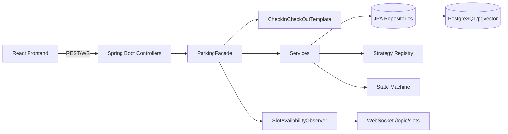
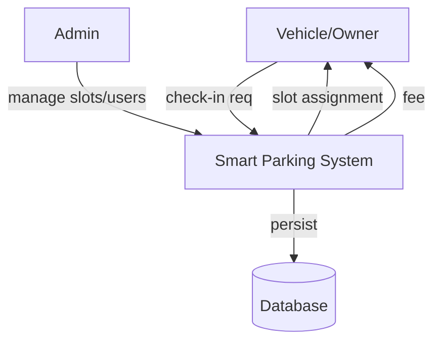
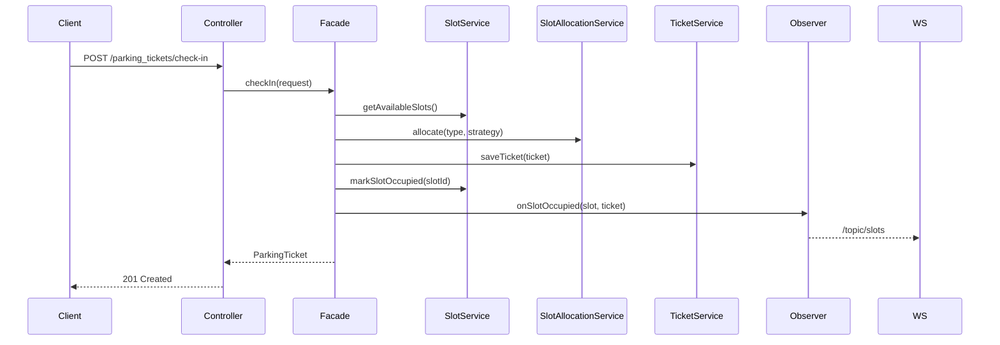
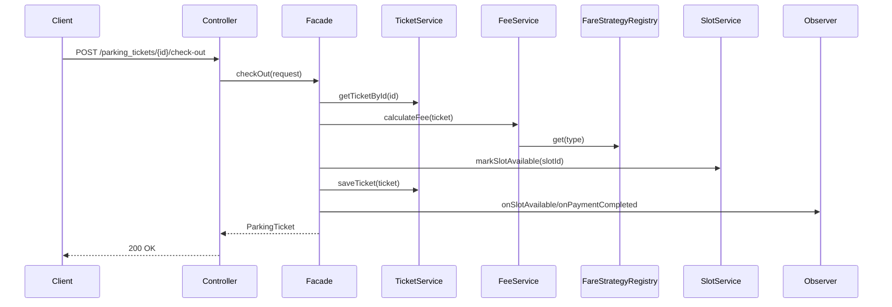
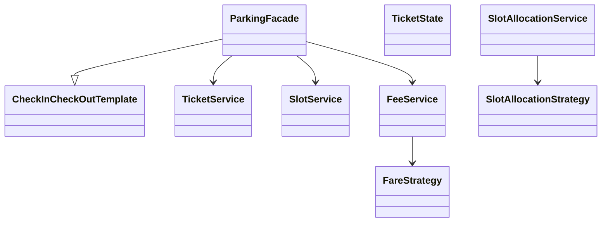

# Smart Parking Lot

Backend + frontend system for managing a multi-floor smart parking lot: spot allocation, check-in/check-out, fee calculation, real-time availability, RBAC auth, and owner self-service.

## Description
A Spring Boot (Java 25) REST API with PostgreSQL/pgvector as the default database and H2 available for local development/tests, secured with JWT + role/privilege RBAC, plus a React + Vite + TypeScript frontend. Implements multiple design patterns (Strategy, State, Template Method, Observer, Facade, Memento, Visitor, Factory) for parking workflows.

## Setup

### Prerequisites
- Java 25 (JDK)
- Gradle (wrapper provided)
- Node.js 20+ and npm (frontend)
- PostgreSQL with the `vector` extension for the default profile

### Backend
```bash
./gradlew bootRun
```
The default `pgvector` profile runs on `http://localhost:8080` and connects to `jdbc:postgresql://localhost:5432/smart_parking`.

Set connection values before starting the backend when they differ from the local defaults:

```bash
export PGVECTOR_DB_URL=jdbc:postgresql://localhost:5432/smart_parking
export PGVECTOR_DB_USERNAME=postgres
export PGVECTOR_DB_PASSWORD=PostGres123
./gradlew bootRun
```

On startup, the `pgvector` profile creates the database and enables the extension automatically. The pgvector extension package must be installed on PostgreSQL, and the configured user needs permission to create databases and extensions. To enable it manually instead:

```sql
CREATE EXTENSION IF NOT EXISTS vector;
```

### Profiles
```bash
./gradlew bootRun --args='--spring.profiles.active=dev'
./gradlew bootRun --args='--spring.profiles.active=prod'
./gradlew bootRun --args='--spring.profiles.active=pgvector'
```
- `pgvector` (default): PostgreSQL/pgvector, ddl-auto=update, credentials from `PGVECTOR_DB_*`
- `dev`: H2 file DB at `./data/parkinglotdb-dev`, ddl-auto=update, DEBUG logging
- `prod`: PostgreSQL/pgvector with ddl-auto=validate and ERROR logging
- `test`: in-memory H2, automatically selected by the Spring Boot context test

### Frontend
```bash
cd front-end
npm install
npm run dev
```
Dev server: `http://localhost:5173`. Vite listens on all interfaces and proxies `/api` to the backend on port 8080. API and WebSocket URLs work from the computer and mobile devices without changing `localhost` in the code.

### Local-network and mobile testing

Start the backend with `./gradlew bootRun` and the frontend with `npm run dev` from `front-end`. On a device connected to the same network, open `http://<computer-LAN-IP>:5173`. Find the computer's IPv4 address with `ip -4 addr show`.

The backend binds to `0.0.0.0:8080` (override with `SERVER_ADDRESS`), so direct API clients can use `http://<computer-LAN-IP>:8080`. The browser uses the Vite proxy by default. When hosting the frontend separately, set `VITE_API_URL` to the backend URL and `APP_CORS_ALLOWED_ORIGINS` to a comma-separated list of permitted frontend origins, including the scheme and port. For a static production deployment, configure a reverse proxy for `/api` or set `VITE_API_URL` during the frontend build.

The existing pgvector Docker container publishes PostgreSQL port 5432 on all interfaces. Database clients on the local network can connect to `<computer-LAN-IP>:5432`, database `smart_parking`, using the configured PostgreSQL credentials. Native PostgreSQL installations require `listen_addresses` and a password-authenticated `pg_hba.conf` entry for the local subnet. Device connectivity also depends on the host firewall and Wi-Fi client isolation.

### Access permissions and vehicle validation

The frontend retrieves the signed-in user's authorities and resource permissions from `GET /auth/me`. Table reads, create/edit/delete controls, navigation, and ticket actions follow those permissions. Backend checks remain authoritative, and the same resource policy supplies the API rules and frontend permissions.

Vehicle registrations must include the letter series (for example `MH10AB1234`). `MH101234` is rejected with a `400` JSON validation message. Invalid sessions return `401`, insufficient privileges return `403`, duplicate registrations return `409`, and unexpected failures return `500`; application errors no longer become empty `401` responses during error dispatch.

## Initial Setup (curl script)
Run the provided RBAC bootstrap script against a running backend:
```bash
bash first_initial_setup.sh
```
It logs in as `admin/admin123`, creates roles, privileges, assigns them, and seeds the admin user. See `docs/RBACCurlSetup.md` for manual steps.

### Dummy owners, licenses, vehicles, and logins

With the backend running, seed 100 linked records of each kind:

```bash
./seed_dummy_records.sh
```

Requires Bash and Python 3 with no extra packages. The script also creates the 100 addresses and Aadhaar records required by the owners, reuses existing vehicle types (or creates a sedan type when none exist), and registers an `OWNER` account for each owner. Usernames are `dummy_owner_001` through `dummy_owner_100`; each account links to its owner's Aadhaar ID. Every saved password is verified by signing in.

Credentials and owner/license/plate identifiers are saved as tab-separated text in `password.txt` beside the script. The file has permissions `600` and is ignored by Git. Keep it for reruns: the script reuses records and passwords, resumes interrupted runs, and refuses to overwrite conflicting identities or reset existing passwords.

Defaults match the setup scripts: `BASE_URL=http://localhost:8080`, `ADMIN_USER=admin`, and `ADMIN_PASS=admin123`. Override these with environment variables. Use `--count` and `--start-index` to seed another range; all indices must stay within `1..9999`:

```bash
BASE_URL=http://localhost:8080 ./seed_dummy_records.sh --count 100 --start-index 101
./seed_dummy_records.sh --help
```

Use `--password-file /path/to/password.txt` or `PASSWORD_FILE` to change the output location. Reruns must use the same credentials file as the original run.

## Account and parking setup
### User profile settings

Every signed-in user can open **Profile settings** at `/profile` from the navigation or their avatar, including accounts without table-management privileges. Users can change their display name, upload/replace/remove a JPG or PNG profile image (up to 2 MB), and change their password using their current password and a matching confirmation. Images are checked, cropped to a square, and saved in the database. Private image requests use the current user's bearer token.

Password changes keep the current session and invalidate the same user's other sessions. Passwords require at least 8 characters; the BCrypt input limit is also enforced. Existing user roles, usernames, and owner links are read-only in these settings.

The default `pgvector`/`dev` profiles create `user_profile` automatically. Before using the `prod` profile with schema validation, apply [docs/user-profile-schema.sql](docs/user-profile-schema.sql).

Self-service endpoints: `GET`/`PUT /auth/profile`, `GET`/`PUT`/`DELETE /auth/profile/image` (upload a multipart field named `image`), and `PUT /auth/profile/password` with `currentPassword`, `newPassword`, and `confirmPassword`.

### Floors and vehicle sections

```bash
./seed_parking_slots.sh --dry-run
./seed_parking_slots.sh
```

Creates/fills **55 floors with 80 slots per floor (4,400 slots)**, balancing each floor across the configured vehicle types. Vehicle types act as sections, labeled A, B, C, etc. in the printed legend; new slot numbers follow `F01-A-001`. Duplicate type names share a section. Existing slots count toward the capacity and retain their current vehicle-type assignment; unassigned slots receive a section. The script aligns `floorLimit` and `floorSlotCapacity`, uses each type's hourly rate for new slots, sets a 10-hour allocation duration, and verifies the final counts. It refuses to remove slots if a floor already exceeds the requested capacity.

Reruns reuse existing slots. Requires Bash/Python 3, a running backend, and vehicle types (use `setup_vehicle_types.sh` if needed). `BASE_URL`, `ADMIN_USER`, and `ADMIN_PASS` use the same defaults as the other setup scripts. `--floors`, `--slots-per-floor`, and `--workers` override the defaults.

The Parking slots table loads every API page and provides floor and vehicle-section filters, so slots on all 55 floors remain searchable beyond the first 1,000 records.

## Core Features (per problem statement)

- Parking spot allocation by vehicle size/type (motorcycle, car, bus) via Strategy pattern (`NearestSlotStrategy`, `BestFitByTypeStrategy`).
- Check-in and check-out with entry/exit time tracking.
- Fee calculation based on duration and vehicle type (hourly/daily rates, multipliers).
- Real-time availability updates via Observer + WebSocket (`/topic/slots`).
- Concurrency handling via pessimistic locking (`findByIdWithLock`, `findAvailableSlotsWithLock`).
- RBAC auth (roles/privileges), owner registration, owner-scoped data access.
- Batch check-in, undo last check-in (Memento), overstay scanning (Visitor).
- Pagination/sorting on list endpoints.

## Architecture & Design Patterns



Patterns: Strategy (fare/slot allocation), State (ticket lifecycle), Template Method (check-in/out flow), Facade (ParkingFacade), Observer (slot events), Memento (undo check-in), Visitor (overstay scan), Factory (vehicle type/slot allocation).

## Diagrams

### DFD (Level 0)


### Sequence (Check-in)


### Sequence (Check-out)


### Class Diagram (core)


## Fee Calculation Engine
- Entry: `FeeService.calculateFee(ParkingTicket)` validates both times, computes `Duration.between(checkIn, checkOut)`.
- Strategy lookup via `FareStrategyRegistry.get(typeName)` (case-insensitive map).
- Strategies:
  - `TwoWheelerFareStrategy`: `hours * hourlyRate` (min 1 hour).
  - `CarFareStrategy`: `max(hours*hourlyRate, (hours/24)*dailyRate)`.
  - `BusFareStrategy`: same as car then `* 1.5`.
- Results stored on ticket: `hourlyRate`, `baseFee`, `totalFee`.
- Ticket state machine guards re-checkout/cancellation.

## Test Suite Setup
Backend tests use JUnit 5 + Mockito + Spring Boot test starters.
```bash
./gradlew test
```
Test classes: `FeeServiceTest`, `SlotAllocationServiceTest`, `SlotServiceTest`, `ParkingSlotServiceTest`, `TicketServiceTest`, `VehicleDetailsServiceTest`, `VehicleOwnerServiceTest`, `ApplicationTests`.

Frontend lint:
```bash
cd front-end/smart-parking-lot
npm run lint
npm run build
```

## Code Coverage
Backend: add JaCoCo plugin to `build.gradle`:
```groovy
plugins { id 'jacoco' }
test { finalizedBy jacocoTestReport }
jacocoTestReport { reports { xml.required = true; html.required = true } }
```
Then:
```bash
./gradlew test jacocoTestReport
# report: build/reports/jacoco/test/html/index.html
```
Frontend: use `@vitest/coverage-v8` with `npm run test -- --coverage`.

### Package-Level Coverage Breakdown (backend)
| Package | Tests Present | Coverage Status |
|---|---|---|
| service (FeeService, SlotAllocationService, SlotService, TicketService, etc.) | Yes | Partial - unit tests exist for FeeService, SlotAllocationService |
| strategy / strategy.slot | Indirect via services | Not directly unit-tested |
| state | No dedicated tests | Not covered |
| facade | No dedicated tests | Not covered |
| controller | No dedicated tests | Not covered |
| repository | No dedicated tests | Not covered |
| observer/listener | No dedicated tests | Not covered |

Run JaCoCo for exact per-package numbers.

## Curl Commands (REST API)

### Auth
```bash
curl -X POST http://localhost:8080/auth/login -H "Content-Type: application/json" -d '{"username":"admin","password":"admin123"}'
```

### Vehicles
```bash
curl -X POST http://localhost:8080/vehicles -H "Content-Type: application/json" -d '{"numberPlate":"MH04AB1234","vehicleType":"{vehicleTypeId}","vehicleBrand":"Honda","vehicleModel":"City"}'
curl -X GET "http://localhost:8080/vehicles"
curl -X GET "http://localhost:8080/vehicles/{vehicleId}"
```

### Parking Slots
```bash
curl -X POST http://localhost:8080/parking_slots -H "Content-Type: application/json" -d '{"slotNumber":"P1","floorNo":1,"floorSlotCapacity":10,"costPerHour":20.0}'
curl -X GET "http://localhost:8080/parking_slots?available=true"
curl -X GET "http://localhost:8080/parking_slots/{slotId}"
```

### Tickets (check-in/out/pay)
```bash
curl -X POST http://localhost:8080/parking_tickets/check-in -H "Content-Type: application/json" -d '{"vehicleId":"{vehicleId}"}'
curl -X POST http://localhost:8080/parking_tickets/{ticketId}/check-out
curl -X POST http://localhost:8080/parking_tickets/{ticketId}/pay -H "Content-Type: application/json" -d '{"amount":50.0}'
curl -X GET "http://localhost:8080/parking_tickets/{ticketId}"
```

### Health
```bash
curl -X GET http://localhost:8080/actuator/health
```
Full list: `docs/curldatafeedtest.md`.

## Profiling Database Switch Triggering
- Hibernate statistics enabled: `spring.jpa.properties.hibernate.generate_statistics=true` and slow query log (`LOG_QUERIES_SLOWER_THAN_MS=10`).
- Actuator exposes metrics: `http://localhost:8080/actuator/metrics` and `.../metrics/hibernate...`.
- Switch DB by activating profile: `--spring.profiles.active=pgvector` (default PostgreSQL) or `--spring.profiles.active=dev` (H2). PostgreSQL settings are in `application-pgvector.properties`; production validation settings are in `application-prod.properties`.
- To profile switch: enable `spring.jpa.show-sql=true`, inspect startup logs for dialect (`PostgreSQLDialect` vs `H2Dialect`), and query timings in logs. The H2 console is available only in the `dev` profile at `/h2-console`.

## License
Internal project.
```

Let me write.<|end|><|start|><|repo_name|>assistant to=write<|channel|>analysis <|constrain|>xml<|message|><rfl:parameter name="content">
# Smart Parking Lot

Backend + frontend system for managing a multi-floor smart parking lot: spot allocation, check-in/check-out, fee calculation, real-time availability, RBAC auth, and owner self-service.

## Actuator Endpoints (localhost)

Base: `http://localhost:8080/actuator`

- Health: http://localhost:8080/actuator/health
- Info: http://localhost:8080/actuator/info
- Metrics (list): http://localhost:8080/actuator/metrics
- Metrics (example): http://localhost:8080/actuator/metrics/jvm.memory.used
- Loggers (list): http://localhost:8080/actuator/loggers
- Logger (example): http://localhost:8080/actuator/loggers/com.smart.parking.lot
- H2 Console: http://localhost:8080/h2-console
